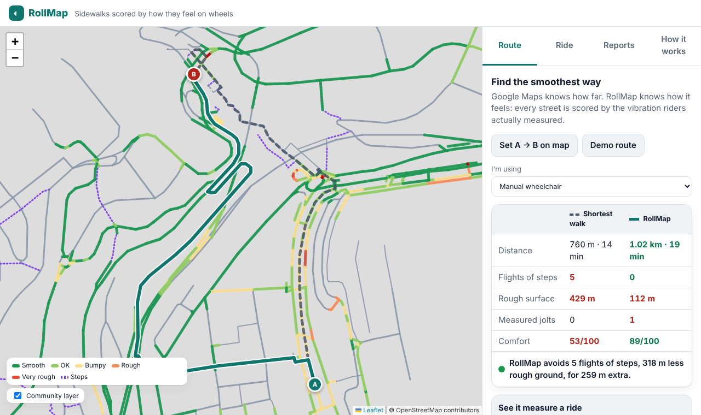

# RollMap

**Sidewalks scored by how they feel on wheels.**

Map apps rate a route by distance. Wheelchair users find the cracked slabs, cobbles, missing curb ramps and steep slopes only when they're already stuck on them. RollMap turns any phone in a wheelchair bag into a sidewalk sensor. It measures the vibration and slope a rider actually feels, scores every street, routes around the bad ones, and turns each problem into a ready-to-send city repair report.

**Live demo:** https://debi910.github.io/rollmap/ (opens on the Monaco demo area)



## What it does

| | |
|---|---|
| **Ride** | Put the phone in the bag (any orientation) and roll. A live comfort gauge, vibration trace, surface type and jolt counter update about every 0.6 s. |
| **Score like a doctor would** | Vibration is frequency-weighted with **ISO 2631-1 W<sub>k</sub>**, the international standard for how the seated human body feels shaking. Each ride gets a comfort score, a vibration dose value (VDV) and the ISO health-guidance zone. |
| **Recognise the ground** | An on-device neural network tells *smooth pavement*, *cracked/broken*, *bricks/pavers* and *gravel/grass* apart. A shock detector flags curb drops and potholes. |
| **Smoothest route** | Dijkstra over OpenStreetMap footpaths. The cost blends measured comfort, jolts, OSM surface and incline tags, and your mobility profile (manual chair, power chair, stroller). Steps are never used. The panel compares it against the shortest walking route. |
| **Report to the city** | Every jolt, rough stretch and steep section becomes a report with GPS location and measured evidence: copy or share as text, or export as GeoJSON (for GIS teams) or an Open311 GeoReport v2 request body (the API many 311 systems accept). |
| **Teach RollMap** | Label what you're rolling on and the app saves labelled feature windows for retraining (`data/real/*.json` → `npm run train`). |

## How it works

```
accelerometer (60–200 Hz, any orientation) ─┐
GPS (1 Hz) ─────────────────────────────────┤
                                            ▼
     resample to 50 Hz, 1.28 s windows, 50 % overlap
     gravity = window mean  →  project onto "down"  →  vertical vibration
                                            │
     ┌──────────────────────┬───────────────┴──────────┬────────────────────────┐
     ▼                      ▼                          ▼                        ▼
 ISO 2631 Wk weighting   15 features (RMS, crest,   jolt detector           tilt vs. calibrated
 → aw, VDV, comfort      kurtosis, band energies,   (peak ≥ 0.8 g &         level → slope flag
   0–100                 periodicity, jerk…) → MLP  crest factor)
                         → surface class
     └──────────────────────┴──────────────┬───────────┴────────────────────────┘
                                           ▼
            snap to OSM street segments → shared comfort layer → router + reports
```

Key files:

- `src/core/wk.ts`: ISO 2631-1 W<sub>k</sub> weighting, checked against the standard's table in `tests/core.test.ts`.
- `src/core/features.ts`: orientation-independent signal processing and feature extraction.
- `src/core/comfort.ts`: comfort bands, health zones and jolt rules.
- `src/ml/mlp.ts`: a tiny MLP with Adam training. No ML runtime; the model ships as about 10 KB of JSON.
- `src/core/synth.ts`: a physics-based generator (wheel–surface excitation through a damped seat/bag resonance, random phone orientation, sensor noise and jitter).
- `src/geo/*`: OSM parsing, the routable graph with a spatial index, segment aggregation and the router.

## Honest status (hackathon build)

- **Training data.** No public wheelchair-vibration dataset with surface labels was reachable during the event, so the classifier is trained on 11,000 windows from the physics-based simulator. Held-out simulated accuracy is **81.7% per 1.3 s window** and **89.5% per street segment**. Real-world accuracy is not yet measured; "Teach RollMap" exists to collect that data. The MyPath research prototype (UMBC, RESNA 2022) reached 92–96% with real wheelchair data, which suggests the approach transfers.
- **Demo community layer.** The Monaco comfort layer comes from **60 simulated rides** pushed through the exact same pipeline the phone runs. Each simulated ride or report is labelled "simulated" in the UI. Streets, steps and lifts are real OpenStreetMap data.
- **Works on real sensors today:** live capture, ISO comfort scoring, jolt and tilt detection, segment mapping, routing and reports. Open the app on an Android phone over HTTPS and press **Start ride**.
- **Not built yet:** a shared backend. Rides are stored on the device and exported as JSON or GeoJSON.

## Run it

```bash
npm install
npm run dev        # http://localhost:5173
npm test           # unit tests: Wk weighting, scoring, orientation independence, jolts, routing
npm run train      # retrain the classifier (synthetic + data/real/*.json)
npx tsx scripts/build-seed.ts 60                                       # regenerate the simulated community layer
npx tsx scripts/build-osm.ts data/monaco.osm.gz public/data/monaco.json  # rebuild the street graph
```

Phone sensors need HTTPS, which the GitHub Pages deploy provides. On iPhone, Safari asks for motion permission when you tap **Start ride**.

## Tools, data and credits

- React 19, TypeScript, Vite, Leaflet. Vitest for tests. Playwright for screenshots and the demo recording.
- Map data © OpenStreetMap contributors (ODbL). Monaco extract from the [GraphHopper](https://github.com/graphhopper/graphhopper) test files.
- Standards: ISO 2631-1:1997 (whole-body vibration), US ADA slope guidance (5% running, 2% cross slope).
- Related work: [Project Sidewalk](https://sidewalk-sea.cs.washington.edu/) (crowdsourced image labels), [MyPath](https://www.resna.org/sites/default/files/conference/2022/PublicTransportation/80_Saha.html) (vibration-based surface classification research), [AccessMap](https://github.com/AccessMap/accessmap-data) (incline-aware routing).
- **AI assistance:** the research, code, tests and write-up were produced with Claude (Anthropic) under the team's direction. The team chose the problem, reviewed the approach and owns the submission.

License: MIT
